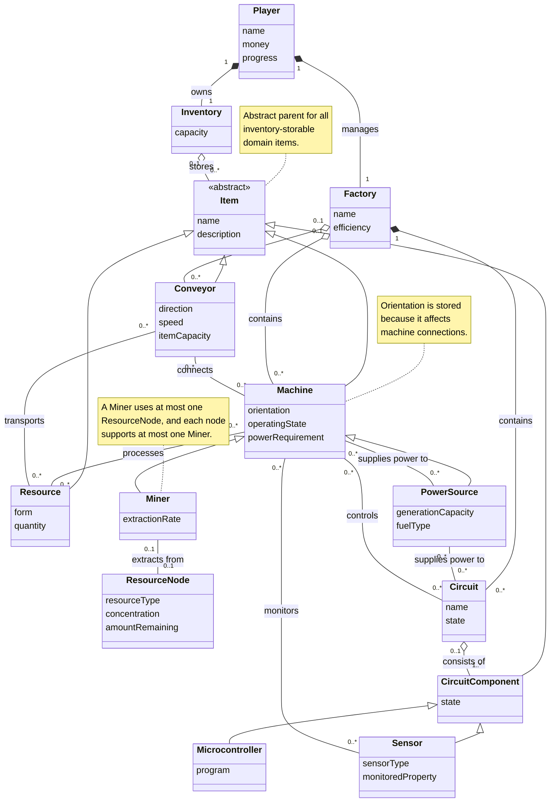

# System Description

Circuit Works serves to address **Player** general electronic knowledge, critical thinking, and engineering mentalities by transforming abstract concepts - such as resource flow, logic circuits, power transformation, product efficiency, and scientific experimentation into interactive, hands-on gameplay. Design infrastructure and how **Players** interact with them incentivize the development of these skills and knowledge. The circuit and logic design system invite creative solutions to power transformation and automated controls, whilst the ever-growing end goal calls for larger inventories and efficient logistics and rewards players with a satisfying result, the more efficient the more satifing. The core gameplay loop heavily rewards players who develop these skills, in most way by developing these skills further. 

# Conceptual Model

# Contribution

Jared(jnp335-sudo) - created D3.md and created the two sections, placing their descriptions in each section to provide info on how each section should be 

Justin(Jpm435-sudo) - created System Description.

D.D - Created Diagram

ehe9 - Reviewed and Edited document
